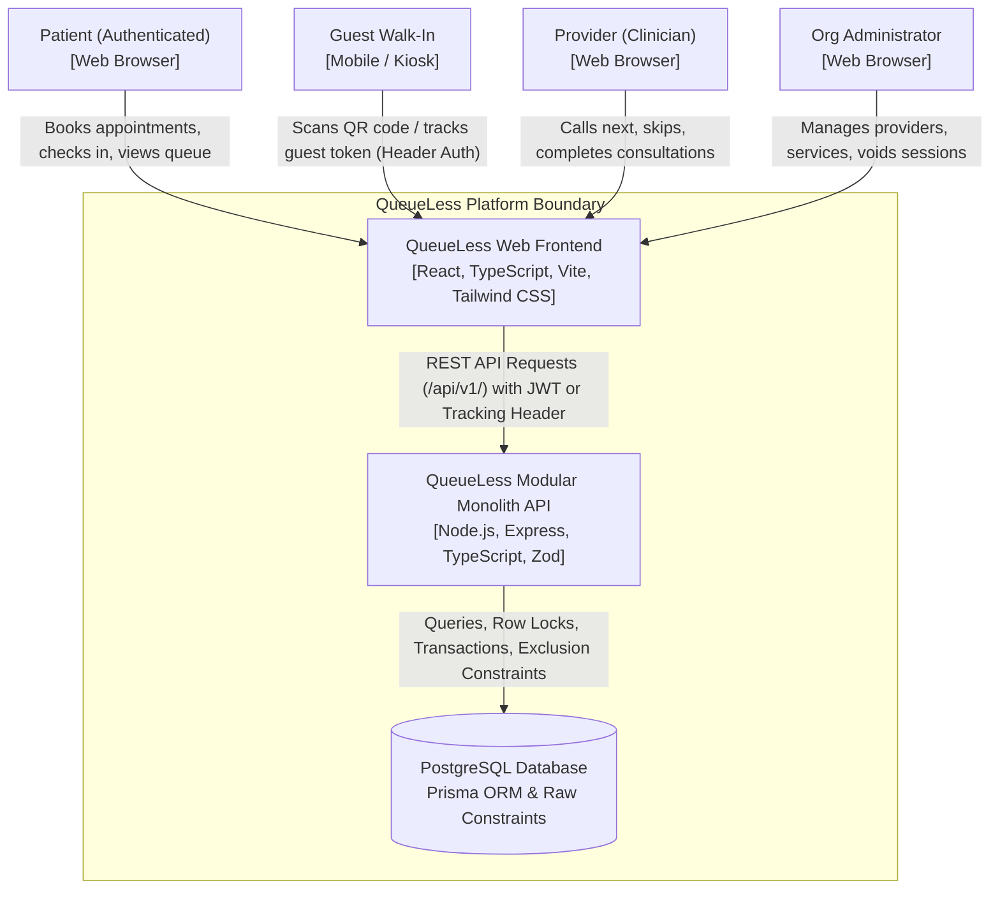

# System Context

**Status:** Approved for Phase 0.

QueueLess is a portfolio-grade appointment and live-queue management platform demonstrating backend Node.js engineering, PostgreSQL relational modeling, concurrency control, event-driven architecture, and cloud infrastructure. Healthcare is used strictly as a fictional demonstration domain.

## Primary Actors

| Actor | Description & Role | Primary Capabilities |
| :--- | :--- | :--- |
| **Patient (Authenticated)** | Self-registered public user. Universal platform identity. | Discovers clinics and services; books non-overlapping appointments; checks in up to 15 min prior; monitors personal queue status via authenticated JWT session; cancels bookings/tokens. |
| **Guest Walk-In (Unauthenticated)** | In-person visitor without a platform user account. | Joins open queue at clinic kiosk/desk; receives physical token number and 256-bit CSPRNG tracking secret; monitors live queue position via private tracking URL (`X-Queue-Tracking-Token` header). |
| **Provider** | Clinician associated with an organization via `PROVIDER` membership. | Manages daily shift queues; advances queue tokens (calls next, starts service, skips absent patients, recalls eligible patients, completes service); views live waiting room rosters. |
| **Organization Administrator** | Staff member holding `ORG_ADMIN` membership in an organization. | Manages clinic locations, services, and provider profiles; schedules queue shifts; voids pre-operational accidental sessions; deactivates providers with coordinated row locking; executes administrative token reinstatements. |

## System Context Diagram (C4 Level 1)

## Phase 1 Boundary

In Phase 1, the entire system operates as a **single modular monolith**:
- **Frontend (`apps/web`)**: Single-page application built with React, TypeScript, Vite, Tailwind CSS, shadcn/ui, TanStack Query, and React Router.
- **Backend API (`apps/api`)**: Node.js, Express, TypeScript, and Zod for schema validation.
- **Data Persistence**: Single PostgreSQL database managed via Prisma ORM for type-safe queries, augmented with custom raw SQL migrations for advanced relational constraints (`btree_gist` exclusion constraints, partial unique indexes, composite foreign keys, and trigger-locked audit tables).

## Later Additions (Phased Progression)

The following architectural components are strictly phase-gated and must not be implemented in Phase 1:
- **Phase 3**: Redis (caching and pub/sub) + WebSockets (real-time live queue push updates) + Synthetic Traffic Simulator.
- **Phase 4**: Apache Kafka + KafkaJS + Transactional Outbox pattern (`outbox_events`).
- **Phase 5**: Kafka Connect + PostgreSQL CDC (Change Data Capture via Debezium).
- **Phase 6**: Dedicated background workers, retry policies, Dead Letter Queues (DLQ), email notifications.
- **Phase 7**: Application containerization (multi-stage Docker builds, Docker Compose).
- **Phase 8**: GitHub Actions CI/CD pipelines.
- **Phase 9**: AWS cloud infrastructure provisioning.
- **Phase 10**: Terraform Infrastructure as Code (IaC).
- **Phase 11**: OpenTelemetry, Prometheus, Grafana, Loki (Observability).
- **Phase 12**: Local Kubernetes (Kind/k3s) and Helm deployment.

## Permanent Scope Exclusions

The following capabilities are permanently out of scope:
- Real patient records, medical charts, diagnoses, prescriptions, lab results, or clinical notes.
- Payments, invoicing, billing, insurance claims, subscriptions, or payment gateways.
- SMS gateway integration (excluded due to carrier fees and lack of durable free tiers; in-app and email used in Phase 6).
- Enterprise SSO, multi-tenant databases, or tenant-routing gateways.
- Microservices architectures from Day 1.
