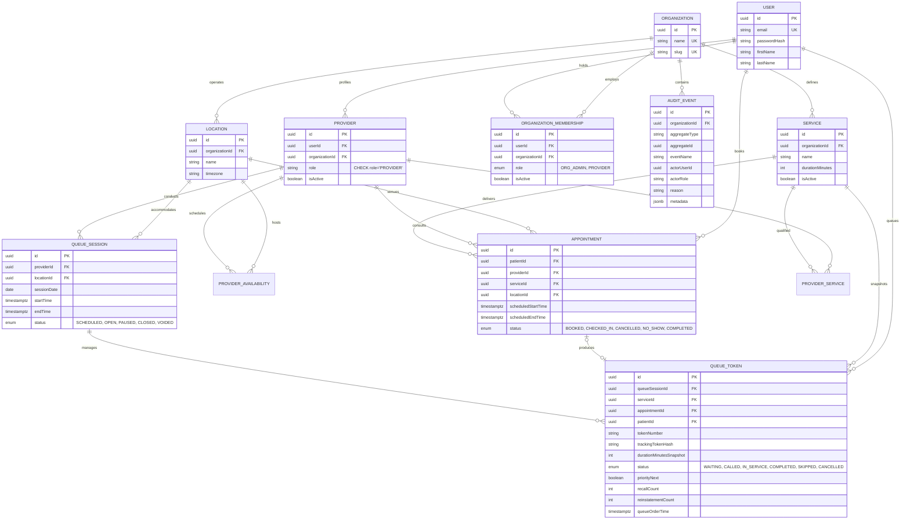

# QueueLess Domain Model & State Specifications

**Status:** Approved for Phase 0.

---

## 1. Core Domain Entities & Attributes

### 1.1 User (Identity Aggregate)
Represents a real human user on the platform. All users have universal patient capabilities by default.
- `id`: UUID (Primary Key, default: `gen_random_uuid()`)
- `email`: VARCHAR(255) (Unique, lowercase, indexed)
- `passwordHash`: VARCHAR(255) (Argon2id hash)
- `firstName`: VARCHAR(100)
- `lastName`: VARCHAR(100)
- `phone`: VARCHAR(20) (Nullable)
- `createdAt`: TIMESTAMPTZ (Default: `NOW()`)
- `updatedAt`: TIMESTAMPTZ (Default: `NOW()`)

### 1.2 Organization
Represents an independent healthcare center or clinic network.
- `id`: UUID (Primary Key)
- `name`: VARCHAR(255) (Unique)
- `slug`: VARCHAR(100) (Unique, URL-friendly)
- `createdAt`: TIMESTAMPTZ
- `updatedAt`: TIMESTAMPTZ

### 1.3 OrganizationMembership
Scopes staff authorization for a user within an organization. A user may hold multiple roles within the same organization.
- `id`: UUID (Primary Key)
- `userId`: UUID (Foreign Key -> `User.id`, `ON DELETE CASCADE`)
- `organizationId`: UUID (Foreign Key -> `Organization.id`, `ON DELETE CASCADE`)
- `role`: Enum (`ORG_ADMIN`, `PROVIDER`)
- `isActive`: BOOLEAN (Default: `TRUE`)
- `createdAt`: TIMESTAMPTZ
- `updatedAt`: TIMESTAMPTZ
- **Constraints**:
  - `@@unique([userId, organizationId, role])`

### 1.4 Location
A physical clinic building or branch operated by an organization.
- `id`: UUID (Primary Key)
- `organizationId`: UUID (Foreign Key -> `Organization.id`, `ON DELETE CASCADE`)
- `name`: VARCHAR(255)
- `timezone`: VARCHAR(50) (IANA timezone string, e.g. `'Asia/Kolkata'`)
- `address`: TEXT (Nullable)
- `createdAt`: TIMESTAMPTZ
- `updatedAt`: TIMESTAMPTZ

### 1.5 Provider
An organization-scoped professional profile for a clinician.
- `id`: UUID (Primary Key)
- `userId`: UUID (Foreign Key -> `User.id`, `ON DELETE RESTRICT`)
- `organizationId`: UUID (Foreign Key -> `Organization.id`, `ON DELETE RESTRICT`)
- `role`: VARCHAR(20) (Fixed check discriminator: `CHECK (role = 'PROVIDER')`, Default: `'PROVIDER'`)
- `title`: VARCHAR(100) (e.g. "MD, Cardiologist")
- `bio`: TEXT (Nullable)
- `isActive`: BOOLEAN (Default: `TRUE`)
- `deactivatedAt`: TIMESTAMPTZ (Nullable)
- `deactivatedByUserId`: UUID (Foreign Key -> `User.id`, Nullable)
- `createdAt`: TIMESTAMPTZ
- `updatedAt`: TIMESTAMPTZ
- **Constraints**:
  - `@@unique([userId, organizationId])`
  - Composite Foreign Key: `FOREIGN KEY (userId, organizationId, role) REFERENCES OrganizationMembership(userId, organizationId, role) ON DELETE RESTRICT`

### 1.6 Service
A medical or consultative service offered by the clinic.
- `id`: UUID (Primary Key)
- `organizationId`: UUID (Foreign Key -> `Organization.id`, `ON DELETE CASCADE`)
- `name`: VARCHAR(255)
- `durationMinutes`: INT (Duration in minutes, e.g. 15, 30, 45; `CHECK (durationMinutes > 0)`)
- `description`: TEXT (Nullable)
- `isActive`: BOOLEAN (Default: `TRUE`)
- `createdAt`: TIMESTAMPTZ
- `updatedAt`: TIMESTAMPTZ

### 1.7 ProviderService
Join entity linking providers to the specific services they are authorized to offer.
- `id`: UUID (Primary Key)
- `providerId`: UUID (Foreign Key -> `Provider.id`, `ON DELETE CASCADE`)
- `serviceId`: UUID (Foreign Key -> `Service.id`, `ON DELETE CASCADE`)
- `createdAt`: TIMESTAMPTZ
- **Constraints**:
  - `@@unique([providerId, serviceId])`

### 1.8 ProviderAvailability
Recurring weekly availability template for a provider.
- `id`: UUID (Primary Key)
- `providerId`: UUID (Foreign Key -> `Provider.id`, `ON DELETE CASCADE`)
- `locationId`: UUID (Foreign Key -> `Location.id`, `ON DELETE CASCADE`)
- `dayOfWeek`: INT (`CHECK (dayOfWeek BETWEEN 0 AND 6)`)
- `startTime`: TIME (Local time string, e.g. `'09:00:00'`)
- `endTime`: TIME (Local time string, e.g. `'17:00:00'`)
- `createdAt`: TIMESTAMPTZ
- `updatedAt`: TIMESTAMPTZ
- **Constraints**:
  - `CHECK (startTime < endTime)`

### 1.9 Appointment
A scheduled calendar booking between a patient and a provider.
- `id`: UUID (Primary Key)
- `patientId`: UUID (Foreign Key -> `User.id`, `ON DELETE RESTRICT`)
- `providerId`: UUID (Foreign Key -> `Provider.id`, `ON DELETE RESTRICT`)
- `serviceId`: UUID (Foreign Key -> `Service.id`, `ON DELETE RESTRICT`)
- `locationId`: UUID (Foreign Key -> `Location.id`, `ON DELETE RESTRICT`)
- `scheduledStartTime`: TIMESTAMPTZ
- `scheduledEndTime`: TIMESTAMPTZ
- `status`: Enum (`BOOKED`, `CHECKED_IN`, `CANCELLED`, `NO_SHOW`, `COMPLETED`)
- `cancellationReason`: VARCHAR(255) (Nullable)
- `cancelledAt`: TIMESTAMPTZ (Nullable)
- `reinstatedAt`: TIMESTAMPTZ (Nullable)
- `reinstatementReason`: VARCHAR(255) (Nullable)
- `createdAt`: TIMESTAMPTZ
- `updatedAt`: TIMESTAMPTZ
- **Constraints**:
  - `CHECK (scheduledStartTime < scheduledEndTime)`

### 1.10 QueueSession
A provider's active shift queue at a location on a specific date.
- `id`: UUID (Primary Key)
- `providerId`: UUID (Foreign Key -> `Provider.id`, `ON DELETE RESTRICT`)
- `locationId`: UUID (Foreign Key -> `Location.id`, `ON DELETE RESTRICT`)
- `sessionDate`: DATE (Local calendar date in clinic timezone)
- `startTime`: TIMESTAMPTZ (Exact UTC shift window start)
- `endTime`: TIMESTAMPTZ (Exact UTC shift window end)
- `status`: Enum (`SCHEDULED`, `OPEN`, `PAUSED`, `CLOSED`, `VOIDED`)
- `voidedAt`: TIMESTAMPTZ (Nullable)
- `voidedByUserId`: UUID (Foreign Key -> `User.id`, Nullable)
- `voidReason`: VARCHAR(255) (Nullable)
- `createdAt`: TIMESTAMPTZ
- `updatedAt`: TIMESTAMPTZ
- **Constraints**:
  - `CHECK (startTime < endTime)`
  - PostgreSQL GiST Range Exclusion:
    `EXCLUDE USING gist (provider_id WITH =, tstzrange(start_time, end_time, '[)') WITH &&) WHERE (status != 'VOIDED')`

### 1.11 QueueToken
Actual physical participation in an active live queue.
- `id`: UUID (Primary Key)
- `queueSessionId`: UUID (Foreign Key -> `QueueSession.id`, `ON DELETE RESTRICT`)
- `serviceId`: UUID (Foreign Key -> `Service.id`, `ON DELETE RESTRICT`)
- `appointmentId`: UUID (Foreign Key -> `Appointment.id`, `ON DELETE RESTRICT`, Nullable)
- `patientId`: UUID (Foreign Key -> `User.id`, `ON DELETE RESTRICT`, Nullable)
- `walkinName`: VARCHAR(100) (Nullable; populated for guest walk-ins)
- `walkinPhone`: VARCHAR(20) (Nullable; populated for guest walk-ins)
- `tokenNumber`: VARCHAR(20) (Human-friendly display number, e.g. `'A-104'`, `'W-201'`)
- `trackingTokenHash`: VARCHAR(64) (SHA-256 hash of 256-bit guest tracking secret, Nullable, Indexed)
- `durationMinutesSnapshot`: INT (Service duration snapshotted at creation)
- `status`: Enum (`WAITING`, `CALLED`, `IN_SERVICE`, `COMPLETED`, `SKIPPED`, `CANCELLED`)
- `priorityNext`: BOOLEAN (Default: `FALSE`)
- `recallCount`: INT (Default: `0`, maximum: `1`)
- `reinstatementCount`: INT (Default: `0`, maximum: `2`)
- `checkInTime`: TIMESTAMPTZ (Immutable original arrival timestamp)
- `queueOrderTime`: TIMESTAMPTZ (Operational queue sort timestamp; initialized to `checkInTime`, reset to `NOW()` on reinstatement)
- `calledAt`: TIMESTAMPTZ (Nullable)
- `serviceStartedAt`: TIMESTAMPTZ (Nullable)
- `completedAt`: TIMESTAMPTZ (Nullable)
- `skippedAt`: TIMESTAMPTZ (Nullable)
- `recalledAt`: TIMESTAMPTZ (Nullable)
- `cancelledAt`: TIMESTAMPTZ (Nullable)
- `cancellationReason`: VARCHAR(255) (Nullable)
- `reinstatedAt`: TIMESTAMPTZ (Nullable)
- `reinstatedByUserId`: UUID (Foreign Key -> `User.id`, Nullable)
- `reinstatementReason`: VARCHAR(255) (Nullable)
- `createdAt`: TIMESTAMPTZ
- `updatedAt`: TIMESTAMPTZ
- **Constraints**:
  - `@@unique([appointmentId])` (Strict 1:1 database invariant; permits multiple `NULL` walk-ins)
  - `CHECK ((patient_id IS NOT NULL AND walkin_name IS NULL) OR (patient_id IS NULL AND walkin_name IS NOT NULL))`
  - Partial Unique Index:
    `CREATE UNIQUE INDEX single_active_call_per_session ON queue_tokens(queue_session_id) WHERE status IN ('CALLED', 'IN_SERVICE')`

### 1.12 AuditEvent
Immutable append-only audit ledger recording business history.
- `id`: UUID (Primary Key, default: `gen_random_uuid()`)
- `organizationId`: UUID (Foreign Key -> `Organization.id`, `ON DELETE RESTRICT`)
- `aggregateType`: VARCHAR(50) (e.g. `'APPOINTMENT'`, `'QUEUE_TOKEN'`, `'QUEUE_SESSION'`, `'PROVIDER'`)
- `aggregateId`: UUID (Indexed)
- `eventName`: VARCHAR(100) (Standardized domain event name)
- `actorUserId`: UUID (Foreign Key -> `User.id`, Nullable)
- `actorRole`: VARCHAR(50) (`'PATIENT'`, `'PROVIDER'`, `'ORG_ADMIN'`, `'SYSTEM'`, `'GUEST'`)
- `reason`: VARCHAR(255) (Nullable)
- `metadata`: JSONB (Default: `'{}'`)
- `createdAt`: TIMESTAMPTZ (Default: `NOW()`)
- **Constraints**:
  - Database Trigger: `trg_audit_events_immutable` raises an exception with stable error message `'Audit records are immutable and cannot be modified or deleted'` (SQLSTATE `P0001`, PostgreSQL default `raise_exception`) on any `UPDATE` or `DELETE`. The application error layer verifies both `error.code === 'P0001'` and matches this message contract before translating to `403 Forbidden` (`AUDIT_LOG_IMMUTABLE`), preventing false-positive mapping of generic `P0001` errors from other database functions. Triggers protect against application logic bugs, but do not prevent alterations by database superusers or database owners.

---

## 2. Mermaid Entity Relationship Diagram (ERD)



---

## 3. Comprehensive State Transition Matrices

### 3.1 Appointment Lifecycle Matrix

The check-in window opens strictly at `scheduledStartTime - 15 minutes` and closes at `scheduledStartTime + 15 minutes` (`APPOINTMENT_CHECKIN_GRACE_MINUTES = 15`). The check-in window **never** extends to `scheduledEndTime`. If a patient has not checked in by `scheduledStartTime + 15 minutes`, the appointment may transition to `NO_SHOW`.

| Current State | Target State | Trigger / Event | Authorized Actor | Guard Conditions | Linked QueueToken Side Effect | Audit Event Recorded |
| :--- | :--- | :--- | :--- | :--- | :--- | :--- |
| **`BOOKED`** | **`CHECKED_IN`** | Patient Check-in | Patient, Staff | $\text{Start} - 15\text{ min} \le \text{NOW} \le \text{Start} + 15\text{ min}$; Active `QueueSession` is `OPEN`. (Does not extend to end time). | Creates `QueueToken` in `WAITING` status (`durationMinutesSnapshot` copied). | `APPOINTMENT_CHECKED_IN` |
| **`BOOKED`** | **`CANCELLED`** | Advance Cancellation | Patient, Staff | Current status is `BOOKED`. | Slot freed. No token exists. | `APPOINTMENT_CANCELLED` |
| **`BOOKED`** | **`NO_SHOW`** | Pre-Check-in Forfeit | Provider, Staff | $\text{NOW} > \text{Start} + 15\text{ min}$ without check-in. | Slot forfeited. No token exists. | `APPOINTMENT_NO_SHOW` |
| **`CHECKED_IN`** | **`COMPLETED`** | Complete Consultation | Provider | Active token transitions `IN_SERVICE -> COMPLETED`. | Synchronized atomically in single transaction. | `APPOINTMENT_COMPLETED` |
| **`CHECKED_IN`** | **`CANCELLED`** | Patient Leaves Waiting Room | Patient, Staff | Active token in `WAITING` or `CALLED` transitions to `CANCELLED`. | Synchronized atomically; sets reason `PATIENT_DEPARTED`. | `APPOINTMENT_CANCELLED` |
| **`CHECKED_IN`** | **`CANCELLED`** | Voluntary Departure after Skip | Patient, Staff | Skipped token transitions `SKIPPED -> CANCELLED` (`PATIENT_DEPARTED`). | Synchronized atomically; sets reason `PATIENT_DEPARTED`. | `APPOINTMENT_CANCELLED` |
| **`CHECKED_IN`** | **`CANCELLED`** | Aborted Consultation | Provider, Staff | Active token in consultation transitions `IN_SERVICE -> CANCELLED`. | Synchronized atomically; sets reason `CONSULTATION_ABORTED`. | `APPOINTMENT_CANCELLED` |
| **`CHECKED_IN`** | **`CANCELLED`** | Session Closure (Clinic Shortfall) | Provider, Staff | Linked token was `WAITING`, `CALLED`, or `SKIPPED` (before 30 min window elapsed). | Synchronized atomically; sets reason `UNSERVED_CLINIC_CLOSED`. | `APPOINTMENT_CANCELLED` |
| **`CHECKED_IN`** | **`NO_SHOW`** | Unresponsive Closure | Provider, Staff | Linked token was `CALLED` (5 min expired) or `SKIPPED` (30 min expired). | Synchronized atomically: Token becomes `CANCELLED`, Appointment becomes `NO_SHOW`. | `APPOINTMENT_NO_SHOW` |
| **`CANCELLED`** | **`CHECKED_IN`** | Staff Reinstatement | Staff, Provider | Same session still `OPEN`; `reinstatementCount < 2`; eligible reason. | Synchronized atomically when token transitions `CANCELLED -> WAITING`. | `APPOINTMENT_REINSTATED` |

---

### 3.2 QueueSession Lifecycle Matrix

| Current State | Target State | Trigger / Action | Authorized Actor | Guard Conditions | Invariant & Side Effects | Audit Event Recorded |
| :--- | :--- | :--- | :--- | :--- | :--- | :--- |
| *(None)* | **`SCHEDULED`** | Schedule Shift | `ORG_ADMIN`, Staff | Start < End; No overlapping session for provider. | Shift window reserved in GiST constraint. | `SESSION_SCHEDULED` |
| **`SCHEDULED`** | **`OPEN`** | Open Clinic Shift | Provider, Staff | Current time within operational window. | Check-ins and patient calling enabled. | `SESSION_OPENED` |
| **`SCHEDULED`** | **`VOIDED`** | Void Mistaken Shift | `ORG_ADMIN` only | **Zero tokens created or served (`COUNT = 0`)**. | `VOIDED` is terminal. Vacates GiST exclusion window. Row retained. | `SESSION_VOIDED` |
| **`OPEN`** | **`PAUSED`** | Pause Queue | Provider | Session is currently `OPEN`. | Calling next suspended; tokens preserved. | `SESSION_PAUSED` |
| **`PAUSED`** | **`OPEN`** | Resume Queue | Provider | Session is currently `PAUSED`. | Calling next restored. | `SESSION_RESUMED` |
| **`OPEN` / `PAUSED`** | **`CLOSED`** | Close Clinic Shift | Provider, Staff | **No token is currently `IN_SERVICE`**. | All unresolved tokens resolved. Terminal state. | `SESSION_CLOSED` |

---

### 3.3 QueueToken Lifecycle Matrix

Tokens belong either to a scheduled appointment (`appointmentId != NULL`) or a walk-in (`appointmentId == NULL`). For guest walk-ins (`userId == NULL`), a 256-bit tracking secret is hashed at rest and permanently revoked upon terminal states (`COMPLETED`, `CANCELLED`).

| Current State | Target State | Trigger / Action | Authorized Actor | Timing & Guard Conditions | Appointment-Linked Side Effect (`appointmentId != NULL`) | Walk-In Side Effect (`appointmentId == NULL`) | Audit Event Recorded |
| :--- | :--- | :--- | :--- | :--- | :--- | :--- | :--- |
| *(None)* | **`WAITING`** | Check-in / Walk-in | Patient, Staff | `QueueSession` is `OPEN`. For appointment: within `[Start - 15m, Start + 15m]`. | Transitions linked `Appointment -> CHECKED_IN`. | Issued standalone. For guest: returns plaintext tracking secret. | `TOKEN_CREATED` |
| **`WAITING`** | **`CALLED`** | Call Next | Provider | Session `OPEN`; **No token `CALLED` or `IN_SERVICE`**. | Priority consumed (`priorityNext = FALSE`). `calledAt = NOW()`. Enforces single active call. | Same token state change. | `TOKEN_CALLED` |
| **`WAITING`** | **`CANCELLED`** | Leave Queue | Patient, Staff | Token is `WAITING`. | `cancelledAt = NOW()`, reason `PATIENT_DEPARTED`. Synchronizes `Appointment -> CANCELLED`. | `cancelledAt = NOW()`, reason `PATIENT_DEPARTED`. Revokes guest secret. | `TOKEN_CANCELLED` |
| **`CALLED`** | **`IN_SERVICE`** | Start Service | Provider | Patient enters consultation room. | Sets `serviceStartedAt = NOW()`. Active call slot remains occupied. | Same token state change. | `TOKEN_SERVICE_STARTED` |
| **`CALLED`** | **`SKIPPED`** | Skip Patient | Provider | Patient absent; **`NOW() >= calledAt + 5 min`**. | `skippedAt = NOW()`. Vacates active call slot. Linked appointment remains `CHECKED_IN`. | `skippedAt = NOW()`. Vacates active call slot. | `TOKEN_SKIPPED` |
| **`CALLED`** | **`CANCELLED`** | Cancel Called Token | Patient, Staff | Patient departs after being called. | `cancelledAt = NOW()`, reason `PATIENT_DEPARTED`. Vacates call slot. `Appointment -> CANCELLED`. | `cancelledAt = NOW()`, reason `PATIENT_DEPARTED`. Vacates call slot. Revokes guest secret. | `TOKEN_CANCELLED` |
| **`IN_SERVICE`** | **`COMPLETED`** | Complete Service | Provider | Consultation finished. | Sets `completedAt = NOW()`. Vacates active call slot. Synchronizes `Appointment -> COMPLETED`. | Sets `completedAt = NOW()`. Vacates active call slot. Revokes guest secret. | `TOKEN_COMPLETED` |
| **`IN_SERVICE`** | **`CANCELLED`** | Abort Consultation | Provider, Staff | Emergency or consultation aborted during service. | Sets `cancelledAt = NOW()`, reason `CONSULTATION_ABORTED`. Vacates call slot. `Appointment -> CANCELLED`. | Sets `cancelledAt = NOW()`, reason `CONSULTATION_ABORTED`. Vacates call slot. Revokes guest secret. | `TOKEN_CANCELLED` |
| **`SKIPPED`** | **`WAITING`** | Recall Skipped | Provider | `recallCount < 1`; session `OPEN`; **`NOW() <= skippedAt + 30 min`**. | Sets `priorityNext = TRUE`, `recallCount = 1`, `recalledAt = NOW()`. Linked appointment remains `CHECKED_IN`. | Same token state change. | `TOKEN_RECALLED` |
| **`SKIPPED`** | **`CANCELLED`** | Voluntary Departure | Patient, Staff | Patient notifies desk they cannot wait (before session close). | Sets `cancelledAt = NOW()`, reason `PATIENT_DEPARTED`. Synchronizes `Appointment -> CANCELLED`. | Sets `cancelledAt = NOW()`, reason `PATIENT_DEPARTED`. Revokes guest secret. | `TOKEN_CANCELLED` |
| **`SKIPPED`** | **`CANCELLED`** | Return Window Expired | Provider, Staff | Patient absent; **`NOW() > skippedAt + 30 min`** while session `OPEN`. | Sets `cancelledAt = NOW()`, reason `NO_SHOW_UNRESPONSIVE`. Synchronizes `Appointment -> NO_SHOW`. | Sets `cancelledAt = NOW()`, reason `NO_SHOW_UNRESPONSIVE`. Revokes guest secret. | `TOKEN_CANCELLED` |
| **`SKIPPED`** | **`CANCELLED`** | Session Closure Resolution | Provider, Staff | Session closing before 30 min expired. | Sets `cancelledAt = NOW()`, reason `UNSERVED_CLINIC_CLOSED`. Synchronizes `Appointment -> CANCELLED`. | Sets `cancelledAt = NOW()`, reason `UNSERVED_CLINIC_CLOSED`. Revokes guest secret. | `TOKEN_CANCELLED` |
| **`CANCELLED`** | **`WAITING`** | Staff Reinstatement | Staff, Provider | Same session still `OPEN`; **`reinstatementCount < 2`**; eligible reason. | Sets `reinstatedAt = NOW()`, `reinstatementCount += 1`, `queueOrderTime = NOW()`. Synchronizes `Appointment -> CHECKED_IN`. | Sets `reinstatedAt = NOW()`, `reinstatementCount += 1`, `queueOrderTime = NOW()`. Generates fresh guest secret if guest. | `TOKEN_REINSTATED` |

---

## 4. Session-Closure Resolution Matrix

Session closure is authorized by an eligible staff or provider actor (`POST /api/v1/queue-sessions/:id/close`), and is **blocked** if any token is currently `IN_SERVICE`. Upon closure, the system deterministically resolves all remaining unresolved active tokens (`WAITING`, `CALLED`, `SKIPPED`) and linked appointments in a single transaction while holding the `QueueSession` lock, strictly according to the matrix below (staff cannot arbitrarily choose a no-show outcome).

Voluntary departures (`PATIENT_DEPARTED`) are recorded during open sessions via normal token cancellation endpoints (`POST /api/v1/queue-tokens/:id/leave`); if a patient departed prior to closure, their token is already in `CANCELLED` status (`PATIENT_DEPARTED`). Thus, at session closure, all tokens remaining in `WAITING` were unserved patients waiting for care and deterministically resolve to `CANCELLED` with resolution reason `UNSERVED_CLINIC_CLOSED`.

| Token State at Closure | Permitted Resolution Reason | Resulting Token Status | Linked Appointment Status | Walk-In Behavior (No Appointment) | Timing & Clinical Rule |
| :--- | :--- | :--- | :--- | :--- | :--- |
| **`WAITING`** | `UNSERVED_CLINIC_CLOSED` | `CANCELLED` | `CANCELLED` *(Reason: UNSERVED_CLINIC_CLOSED)* | `CANCELLED` *(Reason: UNSERVED_CLINIC_CLOSED)* | Clinic shift ended before patient could be seen. Patient is not penalized. |
| **`WAITING`** | `NO_SHOW_UNRESPONSIVE` | **FORBIDDEN** | **FORBIDDEN** | **FORBIDDEN** | **A waiting patient who was never called cannot be marked a no-show.** API rejects with `400 Bad Request`. |
| **`CALLED`** | `NO_SHOW_UNRESPONSIVE` | `CANCELLED` | `NO_SHOW` *(Reason: CALLED_NEVER_RESPONDED)* | `CANCELLED` *(Reason: NO_SHOW_UNRESPONSIVE)* | Permitted **only if `NOW() >= calledAt + 5 min`** before closure. |
| **`CALLED`** | `UNSERVED_CLINIC_CLOSED` | `CANCELLED` | `CANCELLED` *(Reason: UNSERVED_CLINIC_CLOSED)* | `CANCELLED` *(Reason: UNSERVED_CLINIC_CLOSED)* | Mandatory default if clinic closed while 5-minute response window was still active. |
| **`SKIPPED`** | `NO_SHOW_UNRESPONSIVE` | `CANCELLED` | `NO_SHOW` *(Reason: SKIPPED_NEVER_RETURNED)* | `CANCELLED` *(Reason: NO_SHOW_UNRESPONSIVE)* | Permitted **only if `NOW() > skippedAt + 30 min`** before closure. |
| **`SKIPPED`** | `UNSERVED_CLINIC_CLOSED` | `CANCELLED` | `CANCELLED` *(Reason: UNSERVED_CLINIC_CLOSED)* | `CANCELLED` *(Reason: UNSERVED_CLINIC_CLOSED)* | **Mandatory default if session closes before 30-min window expires**. |

---

---

## 5. Dynamic Wait-Time Estimation

Wait time is calculated dynamically per-token using each token's snapshot service duration (`durationMinutesSnapshot`), providing accurate estimates for mixed-service queues (e.g. General Consultation = 30 min, Follow-up = 15 min, Specialist = 45 min):

$$\text{Estimated Wait (Minutes)} = \text{Remaining Active Estimate} + \sum_{T \in S_{\text{ahead}}} T.\text{durationMinutesSnapshot}$$

1. **Tokens Ahead ($S_{\text{ahead}}$)**:
   All `WAITING` tokens in the same `QueueSession` that precede the target token under the hybrid FIFO ordering:
   - Priority recalled tokens (`priorityNext = TRUE`) ordered by `recalledAt ASC NULLS LAST`.
   - Ordinary waiting tokens (`priorityNext = FALSE`) ordered by `queueOrderTime ASC`.
2. **Active Consultation Approximation & Known Limitations**:
   If a token in the session is currently active:
   - **`IN_SERVICE`**: Elapsed consultation time starts at `serviceStartedAt`. Let $\text{elapsedMinutes} = \lfloor(\text{NOW} - \text{serviceStartedAt}) / 60\text{s}\rfloor$. The remaining active estimate is:
     $$\text{Remaining Active Estimate} = \max\left(0, \text{activeToken.durationMinutesSnapshot} - \text{elapsedMinutes}\right)$$
     If the consultation overruns scheduled duration ($\text{elapsedMinutes} > \text{durationMinutesSnapshot}$), the remaining estimate clamps to 0 minutes, acknowledging that overrunning consultations cannot be predicted with certainty without clinical telemetry.
   - **`CALLED`**: The consultation may not have started yet (patient is responding to the call or walking into the consultation room). Elapsed time since `calledAt` is NOT subtracted as though consultation had begun. Instead, $\text{Remaining Active Estimate} = \text{activeToken.durationMinutesSnapshot}$. The estimate is less certain while a token is `CALLED` and may be recalculated when service starts (`IN_SERVICE`).
   - If no token is `CALLED` or `IN_SERVICE`, $\text{Remaining Active Estimate} = 0$.
3. **Operational Presentation**:
   - The result is explicitly presented as an dynamic **estimate**, never as a guaranteed consultation or appointment time.

---

## 6. Reinstatement Eligibility Matrix

Reinstatement is an administrative error-recovery action permitting staff to restore an eligible cancelled token to `WAITING` status at the **tail of the ordinary queue** (`queue_order_time = NOW()`), preserving the immutable original arrival time in `checkInTime`.

| Cancellation Reason / Origin | Reinstatement Eligible? | Policy Approval Status | Required Pre-conditions & Guards | Resulting Token & Appointment States | Audit Event Recorded |
| :--- | :--- | :--- | :--- | :--- | :--- |
| **`ACCIDENTAL_CANCELLATION`** / Administrative Error | **Eligible** | Approved by Owner | Session is `OPEN`; Token is `CANCELLED`; `reinstatementCount < 2`. | Token: `WAITING` (queue tail). Appointment: `CHECKED_IN`. | `TOKEN_REINSTATED`, `APPOINTMENT_REINSTATED` |
| **`PATIENT_DEPARTED`** (Voluntary Departure) | **Eligible** | Approved by Owner | Patient left, but returned while session is still `OPEN`; `reinstatementCount < 2`. | Token: `WAITING` (queue tail). Appointment: `CHECKED_IN`. | `TOKEN_REINSTATED`, `APPOINTMENT_REINSTATED` |
| **`NO_SHOW_UNRESPONSIVE`** (Missed call or expired return window) | **Ineligible** | Approved by Owner | Patient failed to respond. Staff must register a new walk-in or patient books a new appointment. | Blocked (`400 Bad Request`, `NO_SHOW_INELIGIBLE_FOR_REINSTATEMENT`). | None |
| **`CONSULTATION_ABORTED`** (Mid-service abort/emergency) | **Ineligible** | Approved by Owner | Clinical/safety abort. Re-entry requires new clinical evaluation. | Blocked (`400 Bad Request`, `ABORTED_CONSULTATION_INELIGIBLE`). | None |
| **`UNSERVED_CLINIC_CLOSED`** (Clinic shift ended) | **Ineligible** | Approved by Owner | Session is `CLOSED`. Cannot reinstate into a non-open session. | Blocked (`400 Bad Request`, `SESSION_NOT_OPEN`). | None |
| **`ADVANCE_CANCELLATION`** (Cancelled before check-in) | **Ineligible** | Approved by Owner | No `QueueToken` exists (`status = BOOKED`). Appointment must be re-booked. | Blocked (`400 Bad Request`, `NO_TOKEN_TO_REINSTATE`). | None |

---

## 7. Concurrency & Locking Serialization Protocol

To prevent race conditions between session closure, token reinstatement, and cancellations, operations follow the global lock acquisition hierarchy:
`Organization -> Provider -> OrganizationMembership -> QueueSession -> Appointment -> QueueToken`.

1. **Global Lock Acquisition Hierarchy**:
   - Always acquire locks in order: `Organization -> Provider -> OrganizationMembership -> QueueSession -> Appointment -> QueueToken`.
   - When acquiring multiple rows of the same entity (e.g., Appointments or QueueTokens), always acquire locks in deterministic primary-key order (`ORDER BY id ASC`).
2. **Reinstatement Protocol**:
   - Step 1: Acquires `SELECT id, status FROM queue_sessions WHERE id = :sessionId FOR UPDATE`.
   - Step 2: **Re-check Session Status**: Verifies `status === 'OPEN'` after lock acquisition. If closed or paused concurrently, operation fails immediately (`QUEUE_SESSION_NOT_OPEN`).
   - Step 3: If appointment-linked, acquires `SELECT id, status FROM appointments WHERE id = :appointmentId FOR UPDATE`.
   - Step 4: Acquires `SELECT * FROM queue_tokens WHERE id = :tokenId FOR UPDATE`.
   - Step 5: Validates eligibility guards (`reinstatementCount < 2`, eligible reason).
   - Step 6: Reinstates token to `WAITING` at queue tail (`queue_order_time = NOW()`), increments `reinstatementCount`, and synchronizes linked appointment to `CHECKED_IN`.
3. **Session Closure Protocol**:
   - Authorized by an eligible staff or provider actor (`POST /api/v1/queue-sessions/:id/close`).
   - Follows the global lock hierarchy and executes in the following sequence:
     1. **Acquire Session Lock**: Acquires `SELECT id, status FROM queue_sessions WHERE id = :sessionId FOR UPDATE`.
     2. **Pre-check Status & Active Consultations**: Verifies session `status IN ('OPEN', 'PAUSED')`. If already `CLOSED`, returns idempotent success. Verifies zero tokens are `IN_SERVICE`. If a consultation is actively in progress, closure is blocked (`409 Conflict`, `ACTIVE_CONSULTATION_IN_PROGRESS`).
     3. **Identify Affected Records**: Identifies all affected unresolved tokens (`status IN ('WAITING', 'CALLED', 'SKIPPED')`) and extracts their distinct linked `appointment_id` values (where not null) via an inspection query without prematurely acquiring token row locks.
     4. **Lock Appointments in Deterministic PK Order**: If any affected tokens are linked to appointments, acquires row locks on those appointment rows in deterministic primary-key order:
        ```sql
        SELECT id, status FROM appointments
        WHERE id IN (:appointmentIds)
        ORDER BY id ASC
        FOR UPDATE;
        ```
     5. **Lock QueueTokens in Deterministic PK Order**: Acquires row locks on all affected token rows in deterministic primary-key order:
        ```sql
        SELECT id, status, appointment_id, called_at, skipped_at FROM queue_tokens
        WHERE id IN (:tokenIds)
        ORDER BY id ASC
        FOR UPDATE;
        ```
     6. **Mandatory Post-Lock Token State Revalidation**: Revalidates token and appointment states after acquiring locks to confirm no concurrent transition committed. Specifically, if **ANY** affected token has transitioned to `IN_SERVICE` concurrently (which can occur because Start Service acquires `QueueToken FOR UPDATE` without locking `QueueSession`), the transaction **MUST immediately abort and roll back entirely** with `409 Conflict` and error code `ACTIVE_CONSULTATION_IN_PROGRESS`. The transaction must make zero appointment, token, or session updates in this case. This second check is mandatory because Start Service does not acquire `QueueSession FOR UPDATE` and can race with the pre-lock check.
     7. **Deterministic Resolution According to Closure Matrix** (staff cannot arbitrarily choose a no-show outcome):
        - `WAITING` tokens deterministically resolve to `CANCELLED` with reason `UNSERVED_CLINIC_CLOSED`.
        - `CALLED` tokens become `NO_SHOW_UNRESPONSIVE` only after the 5-minute response window (`NOW() >= calledAt + 5 min`).
        - `SKIPPED` tokens become `NO_SHOW_UNRESPONSIVE` only strictly after the 30-minute return window (`NOW() > skippedAt + 30 min`).
        - Unexpired `CALLED` and `SKIPPED` tokens default to `UNSERVED_CLINIC_CLOSED`.
        - **Distinguishes Appointment vs. Walk-In Outcomes**: For appointment-linked tokens (`appointmentId != NULL`), atomically synchronizes `Appointment.status` in the same transaction to `NO_SHOW` (if `NO_SHOW_UNRESPONSIVE`) or `CANCELLED` (if `UNSERVED_CLINIC_CLOSED`). For walk-in tokens (`appointmentId == NULL`), resolves independently to `CANCELLED` with the designated reason and permanently revokes any guest tracking secret.
     8. **Set Session Closed**: Sets `QueueSession.status = 'CLOSED'` and `closed_at = NOW()`.
     9. **Atomic Commit**: Commits the entire operation atomically in one transaction, releasing all locks.
   - Guaranteed invariant: No token can be reinstated, checked in, or called concurrently during closure.

4. **Start Service Concurrency Protocol and Dual Race Handling with Session Closure**:
   - `Start Service` is invoked by a provider (`POST /api/v1/queue-tokens/:id/start-service`) to begin consultation on a `CALLED` patient.
   - **Lock Acquisition**: Start Service acquires a row lock on the target token:
     ```sql
     SELECT id, status, queue_session_id FROM queue_tokens WHERE id = :id FOR UPDATE;
     ```
   - **Mandatory Post-Lock Revalidation**: After acquiring the `QueueToken FOR UPDATE` lock, Start Service revalidates both the token state and the parent `QueueSession` state before transitioning to `IN_SERVICE`:
     - If `token.status !== 'CALLED'`, the transition is invalid: Start Service aborts with `409 Conflict` (error code `INVALID_TOKEN_STATUS` or `TOKEN_NOT_CALLED`).
     - If the parent `QueueSession.status !== 'OPEN'`, the session is no longer operational: Start Service aborts with `409 Conflict` and error code `QUEUE_SESSION_CLOSED` (or `QUEUE_SESSION_PAUSED` if paused).
     - Only if `token.status === 'CALLED'` AND parent `QueueSession.status === 'OPEN'` does Start Service transition `token.status = 'IN_SERVICE'`, set `service_started_at = NOW()`, and commit.
   - **Dual Race Orderings with Session Closure**:
     Because Start Service locks `QueueToken` without acquiring `QueueSession FOR UPDATE`, two distinct race orderings can occur when Start Service and Session Closure execute concurrently:
     - **Race Ordering A (Start Service obtains `QueueToken` lock first)**:
       1. Start Service acquires `QueueToken FOR UPDATE` on the `CALLED` token, confirms `token.status === 'CALLED'` and parent `QueueSession.status === 'OPEN'`, transitions the token to `IN_SERVICE`, and commits.
       2. Session Closure (which holds `QueueSession FOR UPDATE`) subsequently acquires `QueueToken FOR UPDATE` in Step 5.
       3. In Step 6 (Mandatory Post-Lock Token State Revalidation), Session Closure inspects the locked token, detects that it is now `IN_SERVICE`, and **immediately aborts and rolls back completely** with `409 Conflict` and error code `ACTIVE_CONSULTATION_IN_PROGRESS`, making zero appointment, token, or session updates.
     - **Race Ordering B (Session Closure obtains `QueueToken` lock first)**:
       1. Session Closure holds `QueueSession FOR UPDATE`, verifies zero tokens are `IN_SERVICE` in Step 2, and acquires `QueueToken FOR UPDATE` on all affected tokens (including the `CALLED` token) in Step 5.
       2. In Step 6, Session Closure confirms the token is still `CALLED` (not `IN_SERVICE`).
       3. In Step 7, Session Closure deterministically resolves the token according to the closure matrix (to `CANCELLED` with reason `NO_SHOW_UNRESPONSIVE` if the 5-minute response window expired, or `UNSERVED_CLINIC_CLOSED` if unexpired), updates the linked appointment atomically, sets `QueueSession.status = 'CLOSED'` in Step 8, and commits in Step 9.
       4. Start Service (which was blocked waiting for `QueueToken FOR UPDATE`) now acquires the token lock.
       5. Start Service executes its mandatory post-lock revalidation: it inspects the locked token and discovers `token.status !== 'CALLED'` (now `CANCELLED`) and parent `QueueSession.status === 'CLOSED'`.
       6. Start Service **immediately rejects the transition** with `409 Conflict` and error code `QUEUE_SESSION_CLOSED` (or `TOKEN_NOT_CALLED`), aborting with zero updates and preserving the closed session state.
   - **Locking Evaluation (Why Shared `QueueSession` Lock Is NOT Recommended)**:
     If Start Service were instead to acquire `QueueSession FOR SHARE`, it would block Session Closure (`QueueSession FOR UPDATE`) until Start Service completes. However, adding `QueueSession FOR SHARE` introduces an unnecessary lock acquisition on the session row for every consultation start. Mutual exclusion and state integrity across both race orderings are already fully guaranteed by the post-lock revalidations on `QueueToken FOR UPDATE` and parent session state, making a shared session lock redundant overhead.

5. **Multi-Table Transaction Locking Consistency Matrix**:
   To avoid lock-order inversion across concurrent queue lifecycle operations, transactions acquire row-level locks in accordance with the global lock hierarchy:
   `Organization -> Provider -> OrganizationMembership -> QueueSession -> Appointment -> QueueToken`
   Multiple rows of the same entity are always locked in deterministic primary-key order (`ORDER BY id ASC`).

   | Operation | Entity Rows Locked | Lock Acquisition Sequence | Hierarchy Conformance | Safety Rationale If `QueueSession` Is NOT Locked |
   | :--- | :--- | :--- | :--- | :--- |
   | **Call Next** | `QueueSession`, `QueueToken` | `QueueSession FOR UPDATE` -> `QueueToken FOR UPDATE SKIP LOCKED` | `QueueSession -> QueueToken` | Locks `QueueSession` to serialize candidate selection across concurrent staff/providers. |
   | **Start Service** | `QueueToken` | `QueueToken FOR UPDATE` | `QueueToken` | **Safe without `QueueSession` lock via dual post-lock revalidation**: Only 1 active call exists per session, guaranteed by the partial unique index (`status IN ('CALLED', 'IN_SERVICE')`). Both race orderings with Session Closure are deterministically handled: in Race Ordering A, Start Service locks `QueueToken` first and transitions to `IN_SERVICE`, causing Session Closure's post-lock check to abort with `409 Conflict` (`ACTIVE_CONSULTATION_IN_PROGRESS`); in Race Ordering B, Session Closure locks `QueueToken` first, resolves the token, and closes the session, causing Start Service's post-lock check on `QueueToken` to detect `token.status !== 'CALLED'` and parent `QueueSession.status === 'CLOSED'`, rejecting the transition with `409 Conflict` (`QUEUE_SESSION_CLOSED`). |
   | **Skip Patient** | `QueueToken` | `QueueToken FOR UPDATE` | `QueueToken` | **Safe without `QueueSession` lock**: Operates on an already `CALLED` token whose 5-minute response window has elapsed. Linked appointment remains `CHECKED_IN`. Vacates the active slot, allowing the provider to call the next patient. |
   | **Recall Patient** | `QueueSession`, `QueueToken` | `QueueSession FOR UPDATE` -> `QueueToken FOR UPDATE` | `QueueSession -> QueueToken` | Locks `QueueSession` to coordinate queue re-entry with `priorityNext = TRUE` and re-verify session status is `OPEN`. |
   | **Complete Service** | `Appointment` (if linked), `QueueToken` | `Appointment FOR UPDATE` -> `QueueToken FOR UPDATE` | `Appointment -> QueueToken` | **Safe without `QueueSession` lock**: Consultation is already `IN_SERVICE`. Session closure is strictly blocked while any token is `IN_SERVICE` (`409 Conflict`). Completing the consultation transitions token to `COMPLETED` and vacates the active call slot. Lock order (`Appointment -> QueueToken`) matches global hierarchy. |
   | **Advance Cancellation** (before check-in) | `Appointment` | `Appointment FOR UPDATE` | `Appointment` | **Safe without `QueueSession` lock**: Token does not exist yet (`status = BOOKED`). Operates purely on the appointment schedule. |
   | **Token Cancellation** (patient departs waiting room) | `Appointment` (if linked), `QueueToken` | `Appointment FOR UPDATE` -> `QueueToken FOR UPDATE` | `Appointment -> QueueToken` | **Safe without `QueueSession` lock**: Affects only this patient's queue token and linked appointment. Order is `Appointment -> QueueToken`. Because Session Closure ALSO locks `Appointment` before `QueueToken`, their lock acquisition order is identical (`Appointment -> QueueToken`), avoiding lock inversion between these operations. |
   | **Reinstatement** | `QueueSession`, `Appointment` (if linked), `QueueToken` | `QueueSession FOR UPDATE` -> `Appointment FOR UPDATE` -> `QueueToken FOR UPDATE` | `QueueSession -> Appointment -> QueueToken` | Locks `QueueSession` to re-verify session is `OPEN` and serialize queue tail re-entry. Locks linked appointment before token. |
   | **Session Closure** | `QueueSession`, `Appointment` (all linked, in PK order), `QueueToken` (all unresolved, in PK order) | `QueueSession FOR UPDATE` -> `Appointment FOR UPDATE` (PK order) -> `QueueToken FOR UPDATE` (PK order) | `QueueSession -> Appointment -> QueueToken` | Locks `QueueSession` to serialize closure. Gathers records without premature locks. Locks all linked `Appointment` rows in PK order, then all affected `QueueToken` rows in PK order. Mandatory post-lock revalidation aborts with `409 Conflict` (`ACTIVE_CONSULTATION_IN_PROGRESS`) without updates if any token transitioned to `IN_SERVICE` concurrently (Race Ordering A). In Race Ordering B, closure commits first and Start Service's post-lock check rejects on closed session. |

   **Deadlock Avoidance in Queue Lifecycle Paths**: The analyzed queue lifecycle paths follow their documented lock acquisition order and deterministic primary-key ordering, subject to the stated transaction assumptions. This is not a proof of application-wide deadlock freedom.